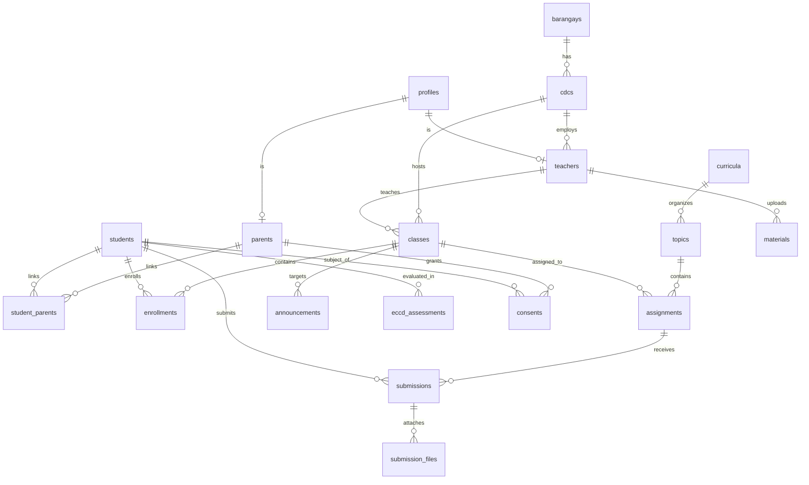

# EarlyLearn Hub — Normalized Schema Proposal (Draft for Review)

This document proposes a normalized PostgreSQL/Supabase schema that replaces packed string fields (`||CODE:`, `||META:`, `[TEACHER_PROFILE_SYNC]`, etc.) with real typed columns, foreign keys, and join tables.

## Entity Relationship Overview

## Tables

| Table | Purpose | Key Columns & Constraints |
|---|---|---|
| `barangays` | Canonical municipality barangays | `id`, `name` (unique), `municipality`, `province` |
| `cdcs` | Child Development Centers & Learning Centers | `id`, `barangay_id` (FK), `name`, `center_type` (`CDC` \| `LC`), `status` (`active` \| `inactive` \| `pending`), `permit_number`, `permit_issued_at`, `permit_expires_at` |
| `profiles` | Base user profile (1:1 with `auth.users`) | `id` (PK/FK `auth.users`), `email`, `full_name`, `phone_number`, `role` (`superadmin` \| `admin` \| `teacher` \| `student`), `must_change_password` |
| `teachers` | Teacher-specific attributes | `id` (PK/FK `profiles`), `teacher_code` (unique), `registration_code` (unique), `cdc_id` (FK `cdcs`), `barangay_id` (FK `barangays`), `position_title`, `is_active` |
| `parents` | Parent/guardian attributes | `id` (PK/FK `profiles`), `occupation`, `address`, `preferred_contact` |
| `students` | Learner records | `id`, `lrn` (optional unique), `first_name`, `middle_name`, `last_name`, `birthdate`, `sex`, `barangay_id` (FK), `cdc_id` (FK), `approval_status` (`pending` \| `approved` \| `rejected`), `approved_by` (FK `profiles`), `approved_at` |
| `student_parents` | M:N link between students and parents | `student_id` (FK), `parent_id` (FK), `relationship`, `is_primary_contact` |
| `classes` | Classrooms/sections | `id`, `cdc_id` (FK), `teacher_id` (FK `teachers`), `name`, `level` (`Pre-K1` \| `Pre-K2` \| `Kindergarten`), `school_year` (e.g. `2026-2027`), `is_active` |
| `enrollments` | Student enrollment in a class | `id`, `student_id` (FK), `class_id` (FK), `enrolled_at`, `status` (`active` \| `transferred` \| `completed` \| `dropped`) |
| `curricula` | Curriculum frameworks | `id`, `title`, `level`, `school_year`, `description`, `created_by` (FK `profiles`) |
| `topics` | Curriculum units/topics | `id`, `curriculum_id` (FK), `title`, `quarter`, `sort_order` |
| `assignments` | Learning tasks/activities | `id`, `topic_id` (FK), `class_id` (FK), `teacher_id` (FK), `title`, `instructions`, `due_at`, `max_score` |
| `materials` | Learning resources (files/links) | `id`, `class_id` (FK), `topic_id` (FK), `teacher_id` (FK), `title`, `description`, `file_url`, `mime_type`, `is_published` |
| `submissions` | Student assignment submissions | `id`, `assignment_id` (FK), `student_id` (FK), `submitted_by` (FK `profiles`), `notes`, `status` (`submitted` \| `reviewed` \| `returned`), `score`, `feedback`, `submitted_at`, `reviewed_at` |
| `submission_files` | Files attached to a submission | `id`, `submission_id` (FK), `file_url`, `file_name`, `mime_type`, `file_size_bytes` |
| `announcements` | School/class announcements | `id`, `cdc_id` (FK), `class_id` (FK, nullable for center-wide), `author_id` (FK `profiles`), `title`, `body`, `published_at` |
| `eccd_assessments` | ECCD checklist evaluations | `id`, `student_id` (FK), `class_id` (FK), `assessor_id` (FK `teachers`), `assessment_period` (`BOSY` \| `MOSY` \| `EOSY`), `assessed_at`, `domain_scores` (JSONB), `raw_total`, `scaled_score`, `interpretation`, `remarks` |
| `consents` | Parent/guardian consent records | `id`, `student_id` (FK), `parent_id` (FK), `consent_type` (`enrollment` \| `media` \| `eccd` \| `data_privacy`), `granted` (boolean), `granted_at`, `revoked_at`, `ip_address` |

## Draft SQL

See [supabase/schema_normalized_draft.sql](file:///C:/earlyLearningHub/EarlyLearn-Hub-2/supabase/schema_normalized_draft.sql).
